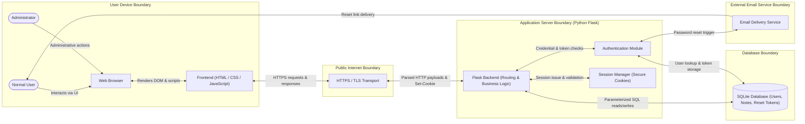
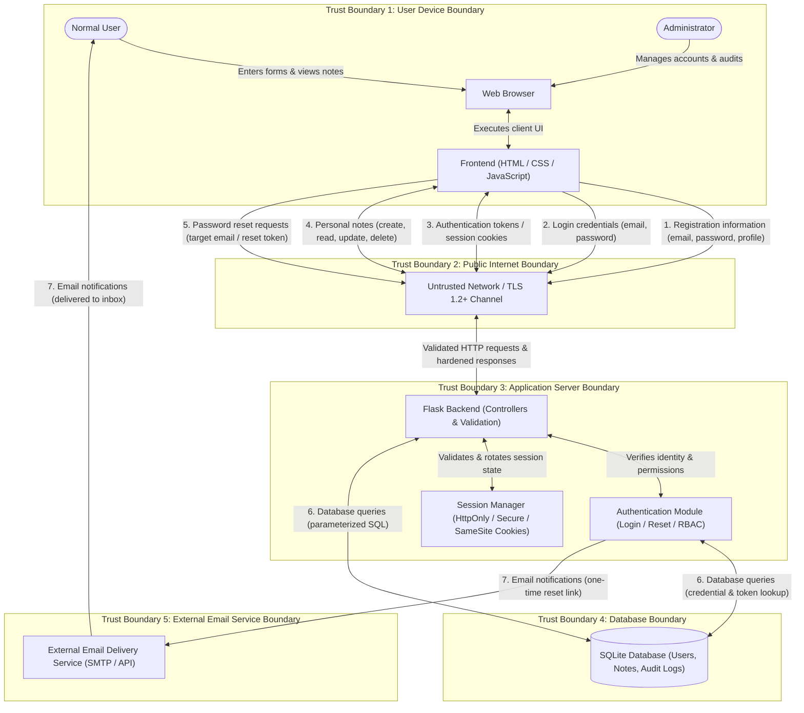

# Threat Model and Secure Configuration — SecureVault

**Track:** Cyber Security · **Level:** Beginner-Friendly · **Target Application:** SecureVault  
**Repository:** [https://github.com/akasshm07/interntask2](https://github.com/akasshm07/interntask2)

---

## 1. Project Overview

This repository contains a defensive application security assessment, threat model, risk register, prioritized hardening plan, and verification checklist for **SecureVault**, a web application designed to store and manage personal notes and user accounts.

The assessment demonstrates how security engineering principles are applied prior to production deployment to identify hypothetical attack paths across trust boundaries and prioritize practical, defense-in-depth mitigations.

---

## 2. Objectives

- Model the **SecureVault** architecture and identify critical assets, actors, data flows, and trust boundaries.
- Conduct a structured **STRIDE** threat analysis across all six threat categories.
- Quantify and prioritize hypothetical security risks using a **Likelihood × Impact** scoring matrix.
- Define a three-phase **Security Hardening Plan** specifying what must change, why it matters, how to implement it in Python Flask and SQLite, and how to verify effectiveness.
- Provide an actionable **Verification Checklist** grounded in OWASP ASVS and NIST standards.

---

## 3. Technologies and Methodologies

| Domain | Technology / Methodology |
| :--- | :--- |
| **Target Application Stack** | HTML, CSS, JavaScript (Frontend) · Python Flask (Backend) · SQLite (Database) · Secure Cookie Sessions · External Email Delivery Service |
| **Threat Modeling** | Data Flow Diagramming (DFD) · Microsoft STRIDE Methodology |
| **Risk Assessment** | 5×5 Likelihood × Impact Matrix (1–25 Risk Score) |
| **Security Frameworks** | OWASP Top 10 (2021) · OWASP ASVS · OWASP Cheat Sheet Series · NIST Cybersecurity Framework (CSF) 2.0 · MITRE CWE |
| **Diagramming** | Mermaid (native GitHub rendering) |

---

## 4. Application Architecture

SecureVault enables registered users to register accounts, log in and log out, view a personal dashboard, manage personal notes, update account information, and reset forgotten passwords via an external email service.



*Full architectural source:* [`diagrams/architecture.mmd`](diagrams/architecture.mmd)

---

## 5. Threat Modeling Approach & Data Flow Diagram

The threat model maps **2 actors** (Normal User, Administrator), **7 application components**, **7 core data flows**, and **5 trust boundaries** to isolate where untrusted inputs enter privileged execution contexts.



*Detailed component, data flow, and boundary explanations:* [`docs/threat-model.md`](docs/threat-model.md) · [`diagrams/threat-model.mmd`](diagrams/threat-model.mmd)

---

## 6. STRIDE Overview

The full STRIDE evaluation in [`docs/threat-model.md`](docs/threat-model.md) documents **hypothetical threats**, attack scenarios, impacts, mitigations, and verification steps across all six categories:

| STRIDE Category | Primary Hypothetical Threats Analyzed | Key Target Components |
| :--- | :--- | :--- |
| **Spoofing** | Account impersonation via credential stuffing, brute-force logins, and session cookie interception | Web Browser, Authentication Module, Session Manager |
| **Tampering** | Modification of other users' notes via IDOR, SQL injection, and CSRF | Frontend, Flask Backend, SQLite Database |
| **Repudiation** | Missing audit trail for failed logins, password resets, note deletions, and admin actions | Flask Backend, Authentication Module, SQLite Database |
| **Information Disclosure** | Verbose Flask debug/error traces, XSS cookie theft, account enumeration, and weak password hashes | Flask Backend, Session Manager, SQLite Database |
| **Denial of Service** | Unthrottled login/hash flooding, oversized note payloads, and email quota exhaustion | Flask Backend, SQLite Database, Email Service |
| **Elevation of Privilege** | Mass assignment (`role=admin` tampering) and predictable or reusable password reset tokens | Flask Backend, Authentication Module |

---

## 7. Risk Assessment Methodology

Hypothetical threats are scored on a 1–25 scale using $\text{Risk Score} = \text{Likelihood (1–5)} \times \text{Impact (1–5)}$:

- **17–25 (Critical):** Immediate remediation required in Phase 1.
- **10–16 (High):** High-priority remediation in Phase 1 / early Phase 2.
- **5–9 (Medium):** Important defense-in-depth improvement in Phase 2.
- **1–4 (Low):** Continuous operational hardening in Phase 3.

---

## 8. Key Security Findings (Top Hypothetical Risks)

Across the **12 risks** cataloged in [`docs/risk-register.md`](docs/risk-register.md), the highest-scoring hypothetical threats are:

1. **RISK-01 — SQL Injection (Score: 20 · Critical):** Unparameterized SQL queries could expose or corrupt the entire SQLite database.
2. **RISK-02 — Insecure Direct Object Reference / IDOR (Score: 20 · Critical):** Missing `user_id` ownership checks on note endpoints could permit reading or modifying other users' notes.
3. **RISK-03 — Improper Role Validation / Mass Assignment (Score: 20 · Critical):** Accepting role attributes from profile updates or missing `@admin_required` decorators could enable privilege escalation.
4. **RISK-04 — Weak Password Hashing (Score: 15 · High):** Fast or unsalted password hashes increase offline cracking risk if the database file is exposed.
5. **RISK-05 — Session Hijacking (Score: 15 · High):** Missing `HttpOnly`, `Secure`, `SameSite`, or HTTPS leaves session cookies vulnerable to interception or theft.
6. **RISK-06 — Password Reset Token Abuse (Score: 15 · High):** Predictable, non-expiring, or reusable reset tokens could enable account takeover.

---

## 9. Prioritized Hardening Recommendations

The full implementation guide in [`docs/security-hardening.md`](docs/security-hardening.md) organizes controls into three phases:

- **Phase 1 — Critical Fixes:** Argon2id/bcrypt password hashing, strict server-side input validation, parameterized SQLite queries, hardened session cookies (`HttpOnly`, `Secure`, `SameSite`), server-side IDOR/role authorization, login/reset rate limiting, and single-use SHA-256-hashed password reset tokens with 15-minute expiration.
- **Phase 2 — Important Improvements:** Synchronizer CSRF tokens, Content Security Policy (CSP), HTTPS/HSTS enforcement, defensive HTTP security headers, OS-restricted SQLite file permissions (`chmod 600`), generic error handling (`FLASK_DEBUG=0`), structured security audit logging, and least-privilege execution.
- **Phase 3 — Additional Hardening:** Automated `pip-audit` dependency checks, encrypted online SQLite backups (`.backup`), account security alert emails, idle/absolute session timeouts, CI security tests (`pytest` + `bandit`), and incident response secret-rotation runbooks.

---

## 10. Verification Checklist Summary

[`docs/verification-checklist.md`](docs/verification-checklist.md) provides **16 verifiable security controls** covering credential storage, SQL parameterization, rate limiting, cookie flags, IDOR/RBAC enforcement, CSRF, error handling, security headers, reset token lifecycle, audit logging, and dependency scanning. All items are initialized as **`Not tested`** until actively verified against a running instance.

---

## 11. Repository Structure

```text
interntask2/
├── README.md
├── docs/
│   ├── threat-model.md
│   ├── risk-register.md
│   ├── security-hardening.md
│   └── verification-checklist.md
├── diagrams/
│   ├── threat-model.mmd
│   └── architecture.mmd
├── assets/
│   └── project-overview.md
└── references/
    └── security-references.md
```

---

## 12. References

See [`references/security-references.md`](references/security-references.md) for direct links to official documentation, including OWASP Top 10, OWASP ASVS, the OWASP Cheat Sheet Series, NIST CSF 2.0, NIST SP 800-63B, Microsoft STRIDE, MITRE CWE, and Pallets Flask security guidance.

---

## 13. Limitations and Assumptions

- **Defensive Educational Scope:** All attack scenarios and risk entries describe **hypothetical threats** derived from architectural threat modeling of SecureVault.
- **No Live Penetration Testing Performed:** This repository does not represent results from a dynamic penetration test or source-code audit of an existing codebase.
- **Unverified Control Status:** All verification checklist items remain marked `Not tested` until an operator executes the defined test procedures against an active deployment.
- **Deployment Assumptions:** SecureVault is modeled as a single-node Python Flask and SQLite application deployed behind a TLS-terminating reverse proxy with an external transactional email provider.
