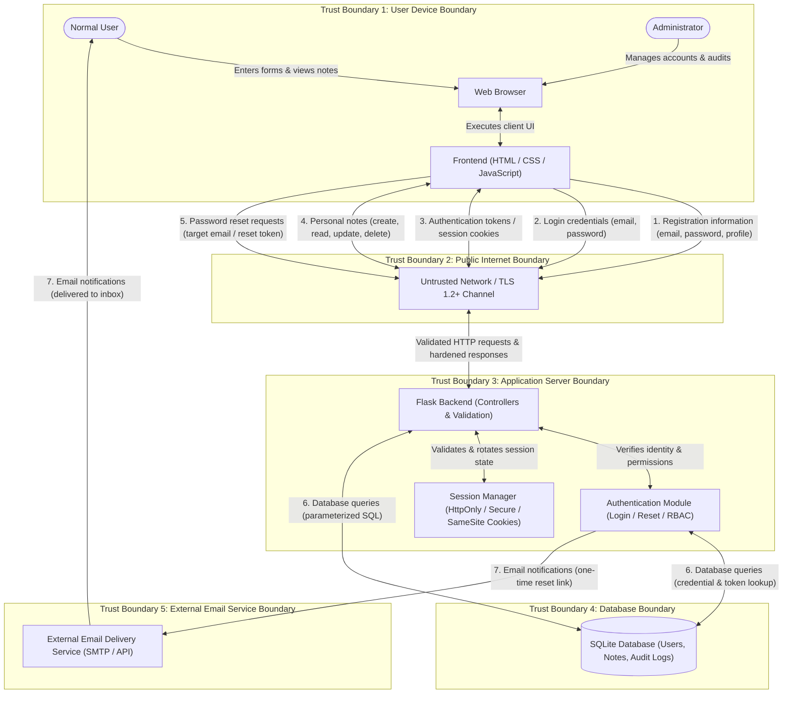

# Threat Model and STRIDE Analysis — SecureVault

> **Assessment Scope Notice:** All threats, attack scenarios, and weaknesses documented in this threat model are **hypothetical threats** derived from architectural analysis of the SecureVault stack. They do not assert that verified vulnerabilities exist in a deployed codebase, nor do they indicate that penetration testing has been performed.

---

## 1. System Overview and Protected Assets

**SecureVault** is a web application enabling registered users to create accounts, authenticate via email and password, view a personal dashboard, manage private notes, and update account details.

### Critical Assets Requiring Protection

| Asset ID | Asset | Sensitivity | Security Properties Required |
| :--- | :--- | :--- | :--- |
| **A-01** | User Credentials (Emails & Password Hashes) | High | Confidentiality, Integrity |
| **A-02** | Personal Notes Content | High | Confidentiality, Integrity, Availability |
| **A-03** | Session Cookies & Signing Keys | Critical | Confidentiality, Integrity |
| **A-04** | Password Reset Tokens | High | Confidentiality, Integrity, Single-Use |
| **A-05** | SQLite Database File (`securevault.db`) | Critical | Confidentiality, Integrity, Availability |
| **A-06** | Application & Security Audit Logs | Medium | Integrity, Availability |

---

## 2. Data Flow Diagram (DFD)

---

## 3. Architecture Decomposition

### 3.1 Actors

- **Normal User**: An unprivileged individual who registers an account, logs in, manages personal notes on their dashboard, updates profile information, and initiates password resets.
- **Administrator**: A privileged operator responsible for user account administration, reviewing security logs, and maintaining system configuration. Administrative privileges represent a high-value target for privilege escalation.

### 3.2 Application Components

- **Web Browser**: The user-agent runtime executing client-side HTML, CSS, and JavaScript, managing the DOM, and storing HTTP cookies sent by the server.
- **Frontend (HTML / CSS / JavaScript)**: Client-side presentation layer rendering registration/login forms, the personal dashboard, note editors, and account settings views. Client-side validation here is purely for usability and must never replace server-side enforcement.
- **Flask Backend**: Python Flask web server handling HTTP routing, request parsing, server-side input validation, authorization checks, template rendering, and error handling.
- **Authentication Module**: Dedicated server-side logic handling account registration, password hashing verification, login throttling, role validation, and password reset token generation/consumption.
- **Session Manager**: Component responsible for creating, signing, validating, rotating, and expiring cookie-based user sessions using Flask's cryptographic signing mechanism and hardened cookie attributes.
- **SQLite Database**: Embedded file-based relational database storing user records, hashed credentials, personal notes, password reset token hashes, and security audit entries.
- **Email Service**: External third-party SMTP or transactional email API used to deliver password reset notifications to users' registered email addresses.

### 3.3 Data Flows

1. **Registration Information**: User-submitted email address, display name, and plaintext password transmitted from the Frontend over HTTPS to the Flask Backend during sign-up.
2. **Login Credentials**: Email and password submitted by the user to the Authentication Module to establish an authenticated session.
3. **Authentication Tokens / Session Cookies**: Cryptographically signed session cookies issued by the Session Manager in `Set-Cookie` headers and automatically attached by the Web Browser on subsequent requests.
4. **Personal Notes**: Private user-authored text payloads created, retrieved, edited, or deleted via authenticated HTTP requests between the Frontend and Flask Backend.
5. **Password Reset Requests**: Unauthenticated requests containing a target email address to trigger a reset, followed by submission of a secret reset token and new password.
6. **Database Queries**: Read and write operations issued by the Flask Backend and Authentication Module against the SQLite Database.
7. **Email Notifications**: Outbound API or SMTP requests from the Authentication Module to the External Email Service containing password reset links destined for the user's inbox.

### 3.4 Trust Boundaries

1. **User Device Boundary**: Separates the physical user and their local Web Browser / Frontend execution environment from external networks. Data inside this boundary can be inspected or modified by the user, browser extensions, or local malware.
2. **Public Internet Boundary**: Untrusted network infrastructure between the user's device and the application server. Traffic crossing this boundary is susceptible to interception, tampering, or replay unless protected by TLS (HTTPS).
3. **Application Server Boundary**: Separates untrusted external HTTP inputs from trusted server-side Python Flask execution, session state management, and authentication decisions. Every request crossing into this boundary must be validated and authorized.
4. **Database Boundary**: Separates the Flask application process from persistent SQLite storage. Crossings require parameterized SQL queries, OS-level file permissions, and strict schema integrity.
5. **External Email Service Boundary**: Separates the internal application server from an external third-party provider outside direct operational control. Credentials for the email API, outbound payload sanitization, and delivery security cross this boundary.

---

## 4. Hypothetical STRIDE Threat Analysis

### Category 1: Spoofing (Identity & Authentication)

| Attribute | Analysis Details |
| :--- | :--- |
| **Hypothetical Threat** | **Account Impersonation via Stolen Credentials or Brute-Force Login** |
| **Relevant Components** | Web Browser, Frontend, Flask Backend, Authentication Module |
| **Attack Scenario** | An attacker obtains a user's email/password from a third-party data breach (credential stuffing) or runs an automated script guessing weak passwords against the `/login` endpoint without rate limiting. Alternatively, an attacker intercepts an unencrypted session cookie over public Wi-Fi to impersonate the victim. |
| **Business / User Impact** | Unauthorized access to private personal notes, unauthorized modification of account email/password, full account takeover, and loss of user trust. |
| **Recommended Mitigation** | Enforce HTTPS exclusively (`Strict-Transport-Security`), apply per-account and per-IP login rate limiting, hash passwords with Argon2id or bcrypt, set `HttpOnly`, `Secure`, and `SameSite=Lax` cookie attributes, and regenerate session identifiers upon login. |
| **Verification Method** | Send 15 rapid invalid POST requests to `/login` and verify HTTP `429 Too Many Requests` is returned. Inspect `Set-Cookie` headers and verify `HttpOnly`, `Secure`, and `SameSite` flags are present. |

---

### Category 2: Tampering (Data Integrity)

| Attribute | Analysis Details |
| :--- | :--- |
| **Hypothetical Threat** | **Unauthorized Modification of Another User's Notes (IDOR) & SQL Injection** |
| **Relevant Components** | Frontend, Flask Backend, SQLite Database |
| **Attack Scenario** | **Scenario A (IDOR):** A logged-in attacker intercepts a `PUT /notes/42` request and changes the note ID to `43`, which belongs to another user. Because the endpoint lacks an ownership check (`WHERE id = ? AND user_id = ?`), the server overwrites the victim's note. **Scenario B (SQLi):** An attacker enters `' OR '1'='1` or stacked SQL payloads into a login or search parameter where raw string formatting was used instead of parameterized queries, altering query logic or modifying database tables. |
| **Business / User Impact** | Corruption or destruction of other users' private data, unauthorized database manipulation, and potential full database compromise. |
| **Recommended Mitigation** | Enforce server-side object-level authorization checking `note.user_id == current_user.id` on every read/write/delete route. Use parameterized SQL queries (`cursor.execute("SELECT * FROM notes WHERE id = ? AND user_id = ?", (note_id, user_id))`) across all database calls. Enable CSRF tokens on all state-changing forms and endpoints. |
| **Verification Method** | Authenticate as User A and attempt `PUT`/`DELETE` on a note ID created by User B; verify HTTP `403 Forbidden` or `404 Not Found` and confirm the database record remains unchanged. Submit SQL metacharacters (`' " ; --`) to form inputs and verify they are treated as literal strings without SQL errors. |

---

### Category 3: Repudiation (Auditability & Non-Repudiation)

| Attribute | Analysis Details |
| :--- | :--- |
| **Hypothetical Threat** | **Lack of Security Audit Logging for Sensitive Actions** |
| **Relevant Components** | Flask Backend, Authentication Module, SQLite Database |
| **Attack Scenario** | An attacker performs repeated failed logins, requests password resets, alters account recovery emails, or deletes notes—or a malicious administrator modifies a user's role—and no structured security logs record timestamps, actor IDs, source IP addresses, or action outcomes. When an incident is reported, investigators cannot reconstruct what happened or prove which account performed the action. |
| **Business / User Impact** | Inability to detect ongoing brute-force attacks, inability to conduct forensic investigations, and non-compliance with standard security monitoring expectations. |
| **Recommended Mitigation** | Implement centralized structured logging (JSON or standard syslog format) for authentication successes/failures, password reset requests, account changes, note deletions, and authorization failures (`403`). Ensure sensitive data (plaintext passwords, session cookies, reset tokens) is never written to logs, and restrict log file write/delete permissions. |
| **Verification Method** | Trigger a failed login, a successful login, a password reset request, and an unauthorized note access attempt; inspect application log files to confirm each event records UTC timestamp, event type, user/target identifier (redacted secret), and outcome. |

---

### Category 4: Information Disclosure (Confidentiality)

| Attribute | Analysis Details |
| :--- | :--- |
| **Hypothetical Threat** | **Sensitive Data Exposure via Verbose Error Messages, Session Hijacking, & Weak Password Storage** |
| **Relevant Components** | Flask Backend, Session Manager, SQLite Database, Email Service |
| **Attack Scenario** | **Scenario A (Verbose Errors / Debug Mode):** Flask runs with `DEBUG=True` in production or returns raw SQLite tracebacks on malformed input, revealing file paths, SQL table schemas, or `SECRET_KEY` environment details. **Scenario B (Session Hijacking via XSS):** A user stores `` in a personal note, and the frontend renders it with `innerHTML` instead of safe text escaping, leaking session cookies if `HttpOnly` is missing. **Scenario C (Account Enumeration):** The `/forgot-password` or `/login` endpoint returns `"Email not found"` vs `"Invalid password"`, allowing attackers to harvest registered user emails. |
| **Business / User Impact** | Exposure of private user notes, leakage of internal server architecture, automated user email harvesting, and offline cracking of password hashes if `securevault.db` is exfiltrated. |
| **Recommended Mitigation** | Disable Flask debug mode in production (`FLASK_DEBUG=0`) and configure generic `400`/`404`/`500` error handlers. Hash passwords with Argon2id/bcrypt. Escape all user output by default (Jinja2 auto-escaping / `textContent` in JS) and enforce a strict Content Security Policy (CSP). Return generic responses on login and password reset endpoints. Restrict OS permissions (`chmod 600`) on `securevault.db`. |
| **Verification Method** | Trigger an unhandled exception or send malformed payloads and verify the HTTP response contains only a generic error message with no stack trace. Verify `HttpOnly` prevents `document.cookie` access in browser DevTools. |

---

### Category 5: Denial of Service (Availability)

| Attribute | Analysis Details |
| :--- | :--- |
| **Hypothetical Threat** | **Resource Exhaustion via Unbounded Requests, Oversized Note Payloads, & Email Flooding** |
| **Relevant Components** | Flask Backend, Authentication Module, SQLite Database, Email Service |
| **Attack Scenario** | **Scenario A (Request / Hash Flooding):** An attacker sends thousands of concurrent `/login` or `/register` requests, forcing the server to perform expensive Argon2id/bcrypt computations and exhausting CPU threads or SQLite write locks (`database is locked`). **Scenario B (Oversized Payloads):** An attacker submits multi-megabyte note bodies in a loop, filling disk space on the host running SQLite. **Scenario C (Email Service Exhaustion):** An attacker abuses `/forgot-password` in a loop to trigger thousands of outbound emails, exhausting third-party email API quotas and causing legitimate password resets to fail. |
| **Business / User Impact** | Application becomes unresponsive for legitimate users, SQLite write contention causes failed saves, and external email service accounts risk suspension or unexpected billing. |
| **Recommended Mitigation** | Configure `MAX_CONTENT_LENGTH` in Flask (e.g., 1 MB) and enforce strict character limits on note fields. Apply rate limiting (e.g., Flask-Limiter) across authentication, password reset, and write endpoints. Configure SQLite WAL mode and busy timeouts, and run Flask behind a production WSGI server (e.g., Gunicorn) with reverse-proxy request throttling. |
| **Verification Method** | Send an HTTP request exceeding `MAX_CONTENT_LENGTH` and verify HTTP `413 Payload Too Large` is returned. Rapidly invoke `/forgot-password` and verify throttling triggers HTTP `429` before excessive emails are queued. |

---

### Category 6: Elevation of Privilege (Authorization)

| Attribute | Analysis Details |
| :--- | :--- |
| **Hypothetical Threat** | **Privilege Escalation via Improper Role Validation & Password Reset Token Abuse** |
| **Relevant Components** | Flask Backend, Authentication Module, Session Manager |
| **Attack Scenario** | **Scenario A (Mass Assignment / Client-Controlled Role):** During profile update (`POST /account/update`), the backend blindly binds all JSON/form fields into the user update statement. A normal user adds `role=admin` to the request body, elevating themselves to Administrator. **Scenario B (Weak Password Reset Token):** Password reset tokens are predictable (e.g., sequential IDs, timestamps, or short numeric codes), never expire, or remain valid after first use. An attacker guesses or replays a reset link for an Administrator account to seize administrative control. |
| **Business / User Impact** | Complete compromise of administrative controls, unauthorized access to all user management functions, and systemic breach of application integrity. |
| **Recommended Mitigation** | Explicitly allowlist editable fields (`display_name`, `email`) on profile updates and never accept `role` or `is_admin` from client payloads. Enforce server-side role decorators (`@admin_required`) on every administrative route. Generate password reset tokens with `secrets.token_urlsafe(32)`, store only a SHA-256 hash of the token in SQLite, enforce a 15-minute expiration TTL, and invalidate tokens immediately upon use. |
| **Verification Method** | Submit `role=admin` inside a normal user's profile update request and confirm the user's database role remains `user`. Attempt to access `/admin/*` endpoints as a normal user and verify HTTP `403 Forbidden`. Attempt to reuse an already consumed or expired password reset token and verify rejection. |
